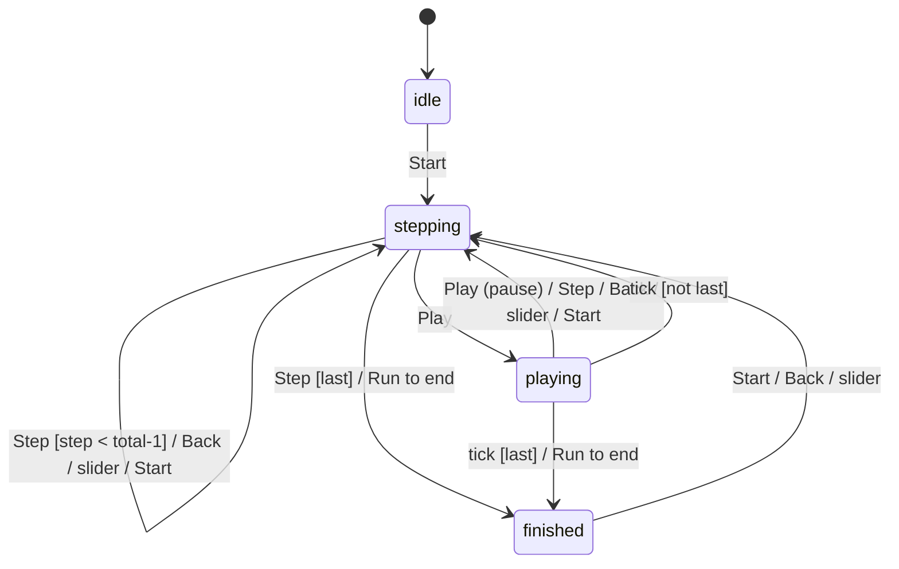

# Statechart step — table first, diagram derived, `foam.FSM` when it earns its keep

## Words

- **State**: a situation the widget can be in where the same click means the same thing. `idle`, `stepping`, `playing`, `finished`.
- **Event**: something the user or the clock does. `Start`, `Step`, `Play`, `tick`, `slider input`.
- **Transition**: "in state S, event E leads to state T". A **guard** is a condition on data that decides between two targets (`Step` in `stepping` goes to `finished` only when `step === total`).
- **DFA** (deterministic finite automaton) and **FSM** (finite state machine) mean the same thing here: exactly one next state for each (state, event).
- **Statechart** (Harel): an FSM plus nesting and parallel regions. `foam.FSM` does not do those; see "Limits".

## 1. The table (the source of truth)

Rows are states, columns are events, cells are the next state. Three cell values only:

| cell | meaning |
|---|---|
| `T` | go to state T (optionally `T / guard: …`) |
| `—` | ignored: the event does nothing here, on purpose |
| `✗` | must be impossible: the control is disabled or hidden in this state |

Worked example (trace player):

| state \ event | Start | Step | Back | Play | slider | Run to end | tick |
|---|---|---|---|---|---|---|---|
| idle | stepping | ✗ | ✗ | ✗ | ✗ | ✗ | — |
| stepping | stepping | stepping / guard: `step < total-1`, else finished | stepping | playing | stepping | finished | — |
| playing | stepping | stepping | stepping | stepping (pause) | stepping | finished | stepping / guard as Step |
| finished | stepping | ✗ | stepping | ✗ | stepping | ✗ | — |

Under the table, list **data events** that change values but not state (edit input text, choose a preset, toggle unfold). They reset or refresh, they do not transition.

Rules, checked before moving on:

1. Every state is reachable from the initial state.
2. Every cell has a value. A blank is a forgotten decision.
3. No hidden state in booleans: if the code would need `isPlaying && isFinished`, that pair is one enum value or a `✗`.
4. Motion, if any, is written next to the transition it belongs to and is disabled under `prefers-reduced-motion`.

## 2. The diagram (derived, never hand-drawn first)

One arrow per non-`—`, non-`✗` cell. Mermaid, pasted into the spec:



Fold parallel arrows with the same source and target into one line, events separated by ` / `.

## 3. `foam.FSM` (declare when the widget has 3+ states)

`foam.FSM` is `FSM.js` in the FSM folder (see SKILL.md, "Where `foam.FSM` lives"; client JS, pom flag `js`); pages load it through `references/fsm-pom`. A state machine is an enum whose values list where they may go.

Mapping from the table:

- one enum value per row;
- `transitions` = the set of distinct target states in that row (events are not named; the table stays the design document);
- `guards` = `{ TARGET: function(x, obj) { … return reason } }` for cells with a guard. **A guard returns the reason the move is REFUSED**: `''` (or anything falsy) allows it, a non-empty string blocks it (`StateMachineEnum.js:197-201` in the FSM folder; `transitionXTo` throws `new Error(reason)`, `:239-248`). Returning `true` for "allowed" silently inverts the guard. Bonus: the reason string is exactly the text to show under the disabled button ("disabled needs a reason"), so write it for the user;
- `isInitial: true` on the initial row; a row with no targets is terminal automatically.

```js
foam.FSM({
  package: 'fsmstudio',
  name: 'TracePlayerState',
  values: [
    { name: 'IDLE',     isInitial: true, transitions: ['STEPPING'] },
    { name: 'STEPPING', transitions: ['STEPPING', 'PLAYING', 'FINISHED'],
      guards: { FINISHED: function(x, obj) { return obj.step >= obj.total ? '' : 'not at the last step yet'; } } },
    { name: 'PLAYING',  transitions: ['STEPPING', 'FINISHED'],
      guards: { FINISHED: function(x, obj) { return obj.step >= obj.total ? '' : 'not at the last step yet'; } } },
    { name: 'FINISHED', transitions: ['STEPPING'] }
  ]
});
```

Use it from the view:

```js
// property on the view
{ class: 'foam.lang.StateMachine', of: 'fsmstudio.TracePlayerState', name: 'state',
  enableHistory: false, enablePayload: false }

// in an action
async function play() { await this.transitionStateTo('PLAYING'); this.startTimer_(); }
```

Checks and the free diagram:

`foam.FSM` ships `validateMachine()`, but in foam3 (development, 2026-10-01) it throws for every machine (`StateMachineEnum.js:421` reads `onTransition`, a property inside the comment at lines 51-71; `test/FSMAxiomInstallTest.js:77` records this). Until that is fixed, paste this checker at the top of the spike view file and call it from `init`:

```js
// Machine sanity check. foam.FSM's own validateMachine() throws on main
// (StateMachineEnum.js:421 reads the commented-out onTransition property), so spikes carry this one.
function checkMachine(E) {
  var names = E.VALUES.map(v => v.name), errs = [];
  var initial = E.VALUES.filter(v => v.isInitial);
  if ( ! initial.length ) errs.push('no initial state');
  E.VALUES.forEach(v => {
    v.transitions.forEach(t => { if ( ! names.includes(t) ) errs.push(v.name + ' -> unknown state ' + t); });
    Object.keys(v.guards || {}).forEach(g => { if ( ! v.transitions.includes(g) ) errs.push(v.name + ': guard for ' + g + ' which is not a transition'); });
  });
  var seen = new Set(initial.map(v => v.name)), queue = [...seen];
  while ( queue.length ) { var n = queue.shift(); E[n].transitions.forEach(t => { if ( ! seen.has(t) ) { seen.add(t); queue.push(t); } }); }
  names.forEach(n => { if ( ! seen.has(n) ) errs.push(n + ' unreachable from initial'); });
  return errs;
}

// in the view's init(): expect []
console.log('checkMachine:', JSON.stringify(checkMachine(fsmstudio.TracePlayerState)));
```

The checker covers the table rules: an initial state exists, every target exists, every guard names a real transition, every state is reachable.

```js
// on the spike page, next to the widget. requires: ['foam.u2.view.FSMDiagramView']
// Defaults are 1600×800 with 400×100 nodes (a whole-screen tool); pass sizes or the boxes overflow the SVG.
// iterations: 0 skips the simulated-annealing pass, so states sit in three deterministic columns
// (initial, middle, terminal) instead of wherever the annealer left them. The template's CSS hides the
// tuning form and the "Improve Layout" button via the spike-fsm class.
// The view draws once and never re-reads data[stateProp], so re-create it from a slot on the state property:
var self = this;
this.add(this.state$.map(function() {
  return self.FSMDiagramView.create({ of: fsmstudio.TracePlayerState, data: self, stateProp: 'state', width: 760, height: 320, nodeWidth: 120, nodeHeight: 44, padding: 60, iterations: 0 }).addClass('spike-fsm');
}));
```

The view also prints its own layout-tuning form (a `DetailView` of its annealing weights) above the SVG. Fine on a spike; hide it with `.foam-u2-DetailView { display: none }` in the page style if it distracts.

`foam.u2.view.FSMDiagramView` (file `FSMDiagramView.js` in the FSM folder; note the package is `foam.u2.view`, not `foam.lang`) renders the machine as SVG and highlights `data[stateProp]`, so the diagram lights up as the user clicks.

## Five or more states: draw it with mermaid, not `FSMDiagramView`

`FSMDiagramView` lays out three columns (initial, middle, terminal) and stacks everything else in the middle one; at nine states it is an unreadable ladder (measured on a nine-state panel). For anything past about four states, generate a mermaid `stateDiagram-v2` on the page from the same machine:

1. `index.html`: `<script src="https://cdn.jsdelivr.net/npm/mermaid@11/dist/mermaid.min.js"></script>` then `mermaid.initialize({ startOnLoad: false, securityLevel: "loose", theme: "neutral", state: { useMaxWidth: false } })`.
2. A constant `EVENTS[from][to] = 'label'` on the view: the states × events table as code, one entry per non-`—` cell.
3. `mermaidSource()`: one `NAME: label` line per state, `[*] --> initial`, one `A --> B: label` per transition, `X --> [*]` for terminals, then `classDef current fill:#eaf3fb,stroke:#0072B2,stroke-width:4px` and `class <current> current`.
4. A framed listener `redraw` subscribed to `state$`: `el.innerHTML = (await mermaid.render('fsm' + Date.now(), this.mermaidSource())).svg`. Call it once at the end of `render()`.
5. Optional nesting: `SpikeDiagram.source(states, edges, groups, classLines)` in the shared helper builds the source and folds groups (`{ REFUND: { label, members: [...] } }` emits `state "label" as REFUND { … }`; an edge every member shares becomes one group edge, a source fanning into two or more members with one label becomes one edge into the group). This is how Cancel/retry returns and sub-machines (a seven-state sub-flow) stop cluttering the picture; it took a 21-state machine from a hairball to two readable lanes. Group by a name prefix when the code already uses one.
6. Give the diagram its own full-width row with `overflow-x: auto`; left-to-right layouts are wide.

7. **Make it interactive** (user rule: the diagram itself is clickable, and hovering a state lights up everything connected to it). Load the skill's `references/spike-diagram.js` after mermaid (from a spike page: `../../../.claude/skills/ui-statechart/references/spike-diagram.js`) and call `SpikeDiagram.render(el, src, edges, { groups, allowed, onClick })` instead of `mermaid.render`. `mermaidSource()` must return `{ src, edges }` with `edges` in the exact order the `-->` lines were emitted (mermaid only numbers them `edge0, edge1, …`; the helper checks the counts match before touching arrows). `allowed(name)` marks clickable states; `onClick(name)` runs the page's own transition. Hover = state + neighbours in amber, rest dimmed to 0.22; the legend must say so.

8. **Every arrow and every move explains itself.** A transition without helper text is a guess for the reader. Put the "when / because" on the move button (second line) and in the arrow's tooltip; derive it from the state's documentation when the machine is real (`transitionHint()` in the viewer splits the doc into clauses at commas, semicolons and "or to X", outside parentheses, and keeps the clauses that name the target as a whole word) or from the events table when the machine is a design. Structure a state's description as facts, not prose: **Means** (first sentence), **⏱ Clock** (any sentence with days/hours/SLA), the rest behind "more". Tooltips are one custom element, white on near-black, 13px (`SpikeDiagram.ensureTip`, anything with `data-tip`); never the browser's `title` bubble (user: "bad contrast"). The tip text is plain with a line syntax the element lays out, so a tip reads like a card, not a wall: `# heading`, `• item` / `⛔ refusal` / `1. step` (glyph in its own column), `~ aside` (muted italic), `@ file:line` (monospace), blank line = gap, `` `code` `` inline chip. Never HTML: guard messages come from source files. Every tip starts with a `#` line naming what is hovered (verb + `api`, state label + `NAME`, `from → to`).
9. **Links between machines are not transitions.** When a widget's state relates to another object's machine (an order to its shipments, one party's record to the other party's), show the relation as a `LINKS` table (`'Machine.STATE' -> [{ to, why, proven }]`) with jump buttons and a proven/inferred tag per row. Never draw a cross-machine arrow as if one machine could move the other.

10. **Two parties, one conversation.** When two machines are two ends of the same exchange (a buyer and a seller on one order), do not draw cross-machine arrows and do not invent a product machine by hand. Find the shared record the code itself keeps (the order row, a message thread, a claim at a third party) and the services, pollers or rules that translate it into each side's state; the joint state is that record, the events are the message catalogue. Page shape that worked for a tester audience: plain-English title with the developer sentence as a subtitle; story bar; one row of *A can* | **banner** (what the last step did, or where to start) over *third party / clock can* | *B can* (a banner on a row of its own left two thirds of the page empty); both diagrams at half width with sub-machines folded (by prefix or by explicit `members` list; while a story plays, states it never visits are greyed); then the shared record beside a full-width timeline. Sides are told apart by three cues at once, never hue alone: position (A always left, B always right), a letter badge (`sides.a.tag`, default the first letter of `short`) on every card header, chip, queue and timeline entry, and a tinted header band plus left stripe on every side card; the banner and the shared cards carry none of those, so they read as "not a side". Impossible events fold away; the B column says "no record yet" until A acts. Field labels are questions a tester would ask ("Payment taken?"), never property names; citations and caveats sit behind a "legend, sources and caveats" toggle. Check every effect against the real FSM transitions and show ⚠ instead of hiding an illegal one: that is how latent cross-side defects surface (one side moves, the other's machine has no edge to follow). An effect may be a **path** (`a: ['WITHDRAWN', 'LOST']`) when one click walks two edges; every hop is checked and the chip shows the whole walk.

## Extract an existing machine (before any config.js)

Do this when the machine already exists and the job is to *read* it (walker, two-party) or to redesign a wizard step on top of it. The enum is the source; never type a state list by hand.

1. **List every machine.** `grep -rl "foam.FSM(" src` in the app, and `foam3/src` too when you want the framework's own test machines. A module that ships separately may keep its machines in its own folder, so grep the whole of `src`, never one folder. Machine id = the `foam.FSM({ package, name })` pair; the page loads the file by its path (`<script src="../../../src/<path>/X.js">`) and reads states from `X.VALUES`.
2. **Classify each one.** *Wizard* machine: values carry `customViewClass` or `stepDescription`; step order comes from `transitions` (`FSMStepWizardView.resolveWizardSteps`), not from file order. *Lifecycle* machine: no view classes, Java `checkGuard` bodies, `scheduledActivity` deadlines. Wizard step count = values with a view class minus those marked `isWizardStep: false` (a value can have both). Do not trust `isWizardStep` alone for the classification: it defaults to true (`FSMStepConfigViews.js:740` only filters `!== false`).
3. **Read the table off the enum.** For each value: `transitions` (targets), `guards` and `checkGuard` (refusals, `guard-messages.js`), `onEnter`/`onExit` (side effects), `scheduledActivity` + `statusNextActivity` (clocks), `documentation` (feed `transitionHint()`). Groups for the diagram = shared name prefixes (`REFUND_`, `RETURN_`); a group with one member is not a group.
4. **Links come from the sync code, not the enums.** The sync code is not always in the enum file: one app keeps it in a method on the child enum, another spreads it over rule actions next to the machines and the parent enum's `onExit`/`onEnter`. `grep -rln "setStatus(\|advanceTo(\|transitionStateTo(" <module dir>` lists every writer. Two machines never reference each other in `transitions`. Find the method that copies one object's state onto another and write one LINKS row per branch of it, tagged `proven: true`. Every row that comes from reading a view or a comment instead is `proven: false` until a second pass (an adversarial subagent reading the same file) confirms it. Direction matters: record which object moves the other.
5. **Two-party shared record.** Two sides of one exchange share a row the code itself keeps; grep the service (or its mock) and the pollers that read it, and the crons that fire deadlines. Events = the message catalogue those translators consume; `wired` when a poller does it, `local` when only one side changes, `clock` when a cron or `scheduledActivity` does it, `manual` when nothing in code does it.
6. **Verify before believing.** Dispatch the verifier blind: give it only the module path and the questions (states, transitions, flags, guard throws per target, cross-machine writers, directions with no code); never the diagram or config. A blind pass typically confirms the state lists, sharpens a few link rows (which side moves first, extra writers), and surfaces side findings the page cannot show. Also run `checkMachine()` (above) on every loaded machine, then one adversarial pass per machine ("list every transition byte-exact from the file, then diff against this table"); on real machines that pass has corrected link rows and surfaced cross-side defects while the enums themselves were exact.

## Redesign an existing wizard (pages into pieces)

Learned redesigning an eight-page form wizard into three steps.

1. **List today's pages from the code, not from memory.** Wizard pages are the values with `isWizardStep: true` and a `stepTitle` / `customViewClass`; cite each with `file:line`. Note variant differences (one variant has a page another lacks).
2. **User stages are not machine states.** The user's sketch names the stages they feel (select, answer, upload, submit); the machine carries more (eligibility checks, waits on a third party). Keep both, and write a map: one row per page state, the machine states it covers. The page is a coarser view over the same machine, so the design needs no backend change to be drawn.
3. **A step boundary earns its place only where work waits.** An asynchronous wait (a third party checking, a case parked) is a real boundary: the user leaves and comes back. System checks that run on entry fold into the step that follows them. Every other page break is only a page break. A page the user asks to keep (a final Review) stays; record it as their override.
4. **Pieces on one page need an unlock rule.** When stages become pieces shown side by side, decide what a piece does before its input exists. Offer three, recommend the first: *visible, waiting* (always on screen, shows why it waits, wakes when the input appears; a waiting piece is read-only, not only labelled waiting), *progressive reveal* (appears when the previous piece is done), *free order* (everything editable, conflicts caught at submit: brings back the late surprise).
5. **Two layers, two tables.** The page machine (which step) is the states × events table as usual. Piece status (waiting / to do / partial / done / problem) is a second, smaller table: glyph, word, hue, meaning. Data events recompute piece status and never change the step.
6. **A check moved earlier is a preview.** If the redesign shows a result sooner than the backend computes it (eligibility before a third-party wait), label it a preview, keep the authoritative check where the backend runs it, and design what happens when they disagree.
7. **Every open question becomes an assumption row** (see SKILL.md): id, question, what the design assumes, what today's code does. Read the code first; it often already decides one half (for example, re-entering a waiting state already skipped every item that had left `OPEN`, so the "re-run?" question was only a business-rule confirmation).
8. **The sketch's layouts become a toggle.** When the user brings more than one layout, the round-1 page switches between them with one control rather than picking one up front.

## Guard refusals without hand-copying

`references/guard-messages.js` fetches a `foam.FSM` source file at page load and pulls every `throw new ValidationException("…")` out of each state's Java `checkGuard`, grouped by the `n.getName()` target it tests (gates, `boolean alias = …` aliases, and helper methods such as `requireResolution` are followed). Both shells take `guardSources` in their config and show the messages as ⛔ bullets under the move/event button and in the arrow tooltip. Zero drift: the page shows the sentence the code would throw. Same trick as `transitionHint()` on the documentation strings. Shapes covered (each found in real machines): `"T".equals(n.getName())` string compares with gates, aliases and helper methods; `newState == T` enum compares, `if ( newState == T ) return;` exclusion gates (stored as `'!T'`, resolved by the shells as "every other target"), `if ( n != A && n != B ) return;` inclusion and `if ( n == A || n == B ) return;` multi-exclusion gates (`'!A!B'`), Yoda compares (`SHIPPED == n`), `} else if (…) {` chains, `methods:` declared before `values:` (the helper scan is bounded to the methods section, or a log line naming a state reads as a helper call), nested `if` blocks, `this.MESSAGE_CONSTANT` resolved from the file's `messages:` list, and a `javaCode` block that holds `checkGuard` *and* `onEnter`/`onExit` together (the parser stops at the guard's closing brace, so onExit throws are not shown as guards; some machines keep refusals in onExit). Sanity-check the parse once in node (`GuardMessages.parse(src)`) when a machine uses a guard shape the header comment does not list.

## Clocks and illustrative dates (two-party shell)

`clocks[side]` rows (anchor, window fields, expiry, and a hand-written *family* tag such as "ours → CANCELLED, guess short" vs "theirs → KEPT, later of two") render as a card above that side's diagram for the current state, with all rows behind a toggle. `calendar.deadline(side, state, row)` returns the arithmetic as text ("later of 20 May + 15 = 4 Jun and 1 May + 45 = 15 Jun → 15 Jun"); events stamp illustrative dates on the row; label it with the seed values and their date. Arithmetic on constants, never on the Java. Format dates with `timeZone: 'UTC'` or day 0 prints a day early.

## Two ready-made shells (no code to write, only a config.js)

- **`references/fsm-walker.template.js`** — walk one or more live `foam.FSM` machines: state card with structured facts and per-move hints, moves as buttons, clickable diagram (move or peek), breadcrumb trail, wizard stepper, cross-machine links with proven/inferred tags and jump/return. Page loads foam.js, the FSM source files, mermaid, `spike-diagram.js`, this template, then a `config.js` that sets `window.SPIKE_WALKER = { title, machines, groups, links, shorten }` (shape documented at the top of the template), then `<foam class="fsmstudio.FsmWalker">`.
- **`references/two-party.template.js`** — two machines that are two ends of one exchange, driven by a shared record and an event catalogue: diagrams on top, *a can* | *third party / clock* + record + timeline | *b can* below, story presets, clickable states with an event chooser, ⚠ on illegal effects. `config.js` sets `window.SPIKE_CONVERSATION = { title, sides: { a, b }, groups, row: { initial, fields, queues(r, A, B), queueLabel }, events, stories, legend, strictPairs, stageOf, stageTip }`. `stageOf(state)` (optional) returns a variant-agnostic stage name, shown as a neutral dashed chip after "now:" on each lane so a reader can compare several variants' pages in one vocabulary; `stageTip(stage)` is its tooltip (line syntax). Keep the generic machine and the map in one spike folder (for example `generic-viewer/stages.js`) and load it from the conversation pages with a plain script tag; the packer copies such a `../<other-spike>/x.js` script next to the packed page as `<other-spike>.x.js` and rewrites the src. On the walker, `lens: { onlyFor, stageOf, schemes: [{ name, a, b }], sideLabels }` adds a second canvas under the generic machine: one variant at a time, its a/b machines with the current stage lit (amber, thick stroke) and the rest greyed, groups collapsed to one node so the pane stays small; the generic nodes carry a second line, `= WORD` when every variant uses that one word (with the variant list when some lack the stage) `≠ n words` when each variant has one state here under a different name (translation), or `n sub-states` when a variant keeps several states inside the stage (the generic stage is coarser); the node tip lists the names per variant and says which case it is. Position + hue + text: the same-versus-different distinction never rests on colour alone. Set `strictPairs: true` when the two records always move together (both rows written in one transaction): an event is then offered only where both its effects are legal edges, so a ⚠ means a real defect, not a pair the rows can never be in. Leave it off when one side can lag the other (a poller runs on a tick), because those lags are the defects you want to see. The page body is `<foam class="fsmstudio.TwoPartyConversation">`.

Worked example in this plugin: `examples/spike-round/` (a design spike in `SpikeShell`). The demo folder of this plugin carries a walker and a conversation config on a small public machine. Mermaid is spike-only; it never enters the product's own views.

## Handing a page to someone without a checkout

`references/pack-spike.mjs --all` writes `ignored/dist/all/`: the doorway `index.html`, one bin, `pom.js`, `shell/`, a `machines/` union, and `spikes/<name>/` per page with paths rewritten to `../../`. `pack-spike.mjs <spike>` writes `ignored/dist/<spike>/` for one page: `foam-bin-3.js` (foam3 core pom + the skill's `fsm-pom`, built by foam3's JSMaker through `tools/pmake.js`, ~2 MB, built once and reused across spikes), `machines/` (the enum files the page's `<script>` tags and `guardSources` name), `shell/` (the skill's helper and template files), `config.js` with its source paths rewritten to `machines/`, a one-line `pom.js`, and the page with its foam.js tag swapped for the bin. Rules learned: double-clicking `index.html` works (guard text and the page list are baked in); served over HTTP, the bin must sit at `/` (foam.js detects `^/foam-bin…` in its own URL), so serve the packed folder from its own root; the page still asks for a project pom, hence the stub `pom.js`; mermaid stays on the CDN unless you copy `mermaid.min.js` beside the page; the packed page is still pure client side, so everything in "Extract an existing machine" still applies. Verified on walker and conversation pages.

## Limits of `foam.FSM` (say them in the spec, do not fight them)

- **Flat.** No nested states, no parallel regions. A tooltip that can be open in any trace state is a second, independent piece of state; keep it in the table as its own small machine and compose by hand.
- **Target-named.** Transitions say "may go to T", not "on event E". The table is the only place events live.
- **Async, auth-aware.** Every `transitionXTo` is a promise and may consult `auth`. Fine for wizard-scale widgets; for a 60 fps canvas tool, drive state with a plain enum property and keep the FSM as the validated diagram.

Below 3 states, skip the FSM: the table and the mermaid diagram are enough.
